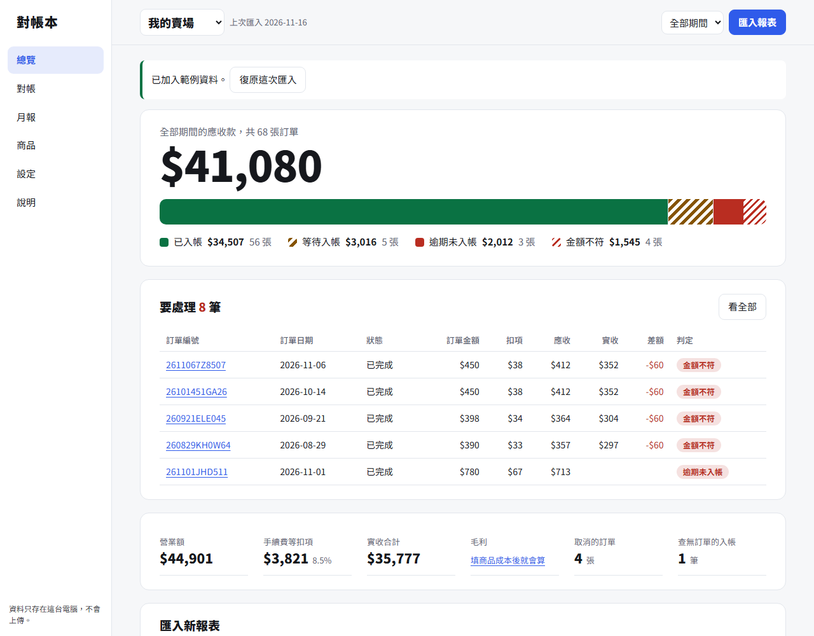

# 對帳本

給電商賣家用的訂單對帳工具。把賣家中心匯出的「訂單報表」和「進帳報表」拖進來，馬上知道哪幾張訂單還沒入帳、哪幾張金額對不上。

資料只存在使用者自己的瀏覽器裡，不會上傳到任何伺服器，也不需要帳號。



## 線上版

- 銷售頁：https://pagani951221-tech.github.io/duizhangben/
- 對帳本（含範例資料）：https://pagani951221-tech.github.io/duizhangben/recon.html#demo

網站由 GitHub Pages 從 `main` 分支直接發布，推送後大約一分鐘更新。

## 檔案

| 檔案 | 用途 |
|---|---|
| `recon.html` | 對帳本主程式，用瀏覽器直接打開就能用 |
| `xlsx.full.min.js` | 讀寫 Excel 的元件，要和 `recon.html` 放在同一個資料夾 |
| `index.html` | 給店家看的銷售頁，也是網站首頁，裡面的「看示範」會打開 `recon.html` |
| `style-*.png`、`landing-preview.png` | 三種外觀風格和銷售頁的預覽圖 |

## 怎麼用

1. 用 Chrome 或 Edge 打開 `recon.html`。
2. 把訂單報表和進帳報表一起拖進視窗，在確認畫面檢查欄位對應後按「匯入」。
3. 到「對帳」看每張訂單的判定，到「月報」和「商品」看整理好的數字。

想先看效果，可以打開 `recon.html#demo`，會自動載入範例資料。程式裡的「說明」頁有每種判定的意思和常見問題。

## 功能

- 自動分辨訂單報表和進帳報表，支援 `.xlsx` 和 `.csv`（UTF-8 或 Big5），民國年日期會自動換算
- 每張訂單一個判定：已入帳、未入帳、逾期未入帳、金額不符、查無訂單、已取消
- 應收公式可調：匯入時勾選哪些欄位要扣掉、哪些要加回來
- 差額有共同規律時會提示，方便找出公式少算了哪個欄位
- 訂單明細、備註、標為已確認（可批次）、複製給平台客服的訊息
- 月報（可列印、可匯出 Excel）、商品銷量、商品成本和毛利、和上個月比較
- 多賣場，各自一本帳
- 匯入後可復原、備份和還原
- 三種外觀風格，淺色和深色

## 銷售頁的聯絡連結

用文字編輯器打開 `index.html`，把最下面這一行換成自己的 LINE 連結，頁面最上方的草稿提示就會自動消失：

```js
const CONTACT_URL = '';
```

## 目前的狀態

- 還沒用真實的平台匯出檔驗證過。欄位名稱是自動猜測加手動調整，應收公式預設是「商品總價減手續費」，實際撥款還會牽涉優惠券和運費，第一次使用時需要用真實報表校正。
- 資料存在瀏覽器的 localStorage，容量上限大約是兩萬張訂單。換電腦或清除瀏覽器資料前要先下載備份。
- 「復原匯入」只在重新整理頁面之前有效。

## 自我檢查

打開 `recon.html#test`，頁面上方會顯示自我檢查的結果。它會測核心邏輯：欄位判斷、金額和日期解析、對帳判定、重複匯入、差額規律、範例資料的統計數字。

## 第三方元件

`xlsx.full.min.js` 是 [SheetJS Community Edition](https://sheetjs.com/) 0.20.3，採用 Apache License 2.0。
